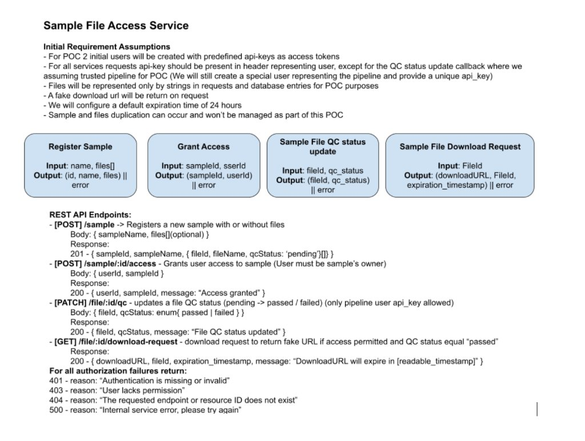

# Sample File Access Service

A lightweight proof-of-concept (POC) HTTP service built with Node.js, TypeScript, Express, and SQLite for persistent storage. It manages sample registrations, file attachments, access permissions, asynchronous QC pipeline status updates, and authorized time-limited download URL generation.

---

## Initial Technical Plan



---

## Getting Started

### Prerequisites

- Node.js 22+ (Node 24 recommended, requires `node:sqlite`)
- npm

### Installation

```bash
npm install
```

### Running Tests and Linting

```bash
npm test        # Runs automated test suite covering access logic
npm run lint    # Runs ESLint checks
```

### Running the Service

```bash
npm start       # Starts the server on http://localhost:3000 (creates data/service.db)
```

---

## Database & Persistence (SQLite)

The service uses Node.js built-in `node:sqlite` (`DatabaseSync`), requiring **zero external database dependencies or native binaries**.

- **Default Database File**: `data/service.db` (auto-created on startup)
- **Configurable Location**: Set `DB_PATH` environment variable (e.g., `DB_PATH=:memory: npm test` or `DB_PATH=/path/to/db.sqlite npm start`)
- **Schema & Relational Integrity**:
  - `users`: Stores user identity, API key, and pipeline role.
  - `samples`: Stores sample ID, name, and owner ID (`FOREIGN KEY -> users(id)`).
  - `sample_files`: Stores file ID, name, sample reference (`FOREIGN KEY -> samples(id)`), and QC status constraint (`CHECK qc_status IN ('pending', 'passed', 'failed')`).
  - `sample_access`: Stores sample-to-user access grants (`PRIMARY KEY (sample_id, user_id)` with foreign keys).

---

## Predefined POC Users & Authentication

All endpoints expect an `x-api-key` header representing the authenticated user:

| User ID         | Role                         | API Key Header            |
| --------------- | ---------------------------- | ------------------------- |
| `user-1`        | Standard User / Sample Owner | `x-api-key: user1-key`    |
| `user-2`        | Standard User / Collaborator | `x-api-key: user2-key`    |
| `pipeline-user` | Trusted Internal QC Pipeline | `x-api-key: pipeline-key` |

---

## Manual Verification (One-Liner `curl` Commands)

Start the service with `npm start`, then run the following one-liner commands to validate each feature and access control rule:

### 1. Register a Sample with Files

```bash
curl -s -X POST http://localhost:3000/sample -H "Content-Type: application/json" -H "x-api-key: user1-key" -d '{"sampleName":"Sample 1","files":["file-a.bam","file-b.bam"]}'
```

_(Expected: `201 Created` with `sampleId`, `sampleName`, and file records with `qcStatus: "pending"`)_

### 2. Register a Sample Without Files (Zero Files)

```bash
curl -s -X POST http://localhost:3000/sample -H "Content-Type: application/json" -H "x-api-key: user1-key" -d '{"sampleName":"Empty Sample"}'
```

_(Expected: `201 Created` with `"files": []`)_

### 3. Verify Authentication Missing or Invalid (401)

```bash
curl -s -i -X GET http://localhost:3000/file/any-file/download-request
```

_(Expected: `401 Unauthorized` with `{"reason":"Authentication is missing or invalid"}`)_

### 4. Verify Download Denied While QC Status is Pending (403)

```bash
curl -s -i -X GET http://localhost:3000/file/<FILE_ID>/download-request -H "x-api-key: user1-key"
```

_(Expected: `403 Forbidden` with `{"reason":"User lacks permission"}`)_

### 5. Verify Non-Pipeline User Cannot Update QC Status (403)

```bash
curl -s -i -X PATCH http://localhost:3000/file/<FILE_ID>/qc -H "Content-Type: application/json" -H "x-api-key: user1-key" -d '{"qcStatus":"passed"}'
```

_(Expected: `403 Forbidden` with `{"reason":"User lacks permission"}`)_

### 6. Pipeline Updates QC Status to Passed (200)

```bash
curl -s -X PATCH http://localhost:3000/file/<FILE_ID>/qc -H "Content-Type: application/json" -H "x-api-key: pipeline-key" -d '{"qcStatus":"passed"}'
```

_(Expected: `200 OK` with `{"fileId":"...","qcStatus":"passed","message":"File QC status updated"}`)_

### 7. Verify Unpermitted User Cannot Download (403)

```bash
curl -s -i -X GET http://localhost:3000/file/<FILE_ID>/download-request -H "x-api-key: user2-key"
```

_(Expected: `403 Forbidden` with `{"reason":"User lacks permission"}`)_

### 8. Verify Non-Owner Cannot Grant Access (403)

```bash
curl -s -i -X POST http://localhost:3000/sample/<SAMPLE_ID>/access -H "Content-Type: application/json" -H "x-api-key: user2-key" -d '{"userId":"user-2"}'
```

_(Expected: `403 Forbidden` with `{"reason":"User lacks permission"}`)_

### 9. Owner Grants Access to Collaborator (200)

```bash
curl -s -X POST http://localhost:3000/sample/<SAMPLE_ID>/access -H "Content-Type: application/json" -H "x-api-key: user1-key" -d '{"userId":"user-2"}'
```

_(Expected: `200 OK` with `{"userId":"user-2","sampleId":"...","message":"Access granted"}`)_

### 10. Permitted User Requests Download URL (200)

```bash
curl -s -X GET http://localhost:3000/file/<FILE_ID>/download-request -H "x-api-key: user2-key"
```

_(Expected: `200 OK` with `downloadURL`, `fileId`, `expiration_timestamp`, and expiration message)_

### 11. Pipeline Updates QC Status to Failed (200)

```bash
curl -s -X PATCH http://localhost:3000/file/<FILE_ID>/qc -H "Content-Type: application/json" -H "x-api-key: pipeline-key" -d '{"qcStatus":"failed"}'
```

_(Expected: `200 OK` with `"qcStatus":"failed"`)_

### 12. Verify Download Denied When QC Status is Failed (403)

```bash
curl -s -i -X GET http://localhost:3000/file/<FILE_ID>/download-request -H "x-api-key: user1-key"
```

_(Expected: `403 Forbidden` with `{"reason":"User lacks permission"}`)_

---

## API Endpoints & Request/Response Contracts

### 1. Register a Sample

`POST /sample`

- **Headers**: `x-api-key: user1-key`
- **Body**:
  ```json
  {
    "sampleName": "Cancer Research Sample A",
    "files": ["genome_sequence.bam", "analysis_summary.pdf"]
  }
  ```
- **Response** (`201 Created`):
  ```json
  {
    "sampleId": "sample_1a2b3c4d-...",
    "sampleName": "Cancer Research Sample A",
    "files": [
      {
        "fileId": "file_1111...",
        "fileName": "genome_sequence.bam",
        "qcStatus": "pending"
      },
      {
        "fileId": "file_2222...",
        "fileName": "analysis_summary.pdf",
        "qcStatus": "pending"
      }
    ]
  }
  ```

### 2. Grant User Access to a Sample

`POST /sample/:id/access`

- **Headers**: `x-api-key: user1-key` (Must be the sample's owner)
- **Body**:
  ```json
  {
    "userId": "user-2"
  }
  ```
- **Response** (`200 OK`):
  ```json
  {
    "userId": "user-2",
    "sampleId": "sample_1a2b3c4d-...",
    "message": "Access granted"
  }
  ```

### 3. Update File QC Status (Pipeline Callback)

`PATCH /file/:id/qc`

- **Headers**: `x-api-key: pipeline-key` (Only pipeline user allowed)
- **Body**:
  ```json
  {
    "qcStatus": "passed"
  }
  ```
- **Response** (`200 OK`):
  ```json
  {
    "fileId": "file_1111...",
    "qcStatus": "passed",
    "message": "File QC status updated"
  }
  ```

### 4. Request Download URL

`GET /file/:id/download-request`

- **Headers**: `x-api-key: user2-key`
- **Condition**: User must be sample owner or granted access **AND** file QC status must be `"passed"`.
- **Response** (`200 OK`):
  ```json
  {
    "downloadURL": "https://download.example.com/files/file_1111...?token=...&expires=...",
    "fileId": "file_1111...",
    "expiration_timestamp": "2026-11-14T17:00:00.000Z",
    "message": "DownloadURL will expire in 24 hours (2026-11-14T17:00:00.000Z)"
  }
  ```

### Standard Error Responses

- `401 Unauthorized`: `{ "reason": "Authentication is missing or invalid" }`
- `403 Forbidden`: `{ "reason": "User lacks permission" }`
- `404 Not Found`: `{ "reason": "The requested endpoint or resource ID does not exist" }`
- `500 Internal Error`: `{ "reason": "Internal service error, please try again" }`

---

## Design Choices & Trade-offs

### Key Choices Made

1. **SQLite Persistent Storage**: Backed by Node.js built-in `node:sqlite` (`DatabaseSync`), storing data in `data/service.db`. This provides true disk persistence and relational integrity (foreign keys, unique constraints, check constraints) with zero npm dependencies.
2. **TypeScript & Node.js Native Test Runner**: Used Node.js built-in `node:test` and `node:assert/strict` via `tsx --test` alongside `supertest`. This eliminates heavy testing framework overhead (like Jest/Babel) while keeping execution fast and zero-config.
3. **Layered Architecture & Typed Errors**: Separated route definitions, services, store, and middleware with domain-specific errors (`NotFoundError`, `ForbiddenError`, `BadRequestError`) handled by a centralized error middleware.

### Assumptions Made

- **Trusted Pipeline**: The QC pipeline is an internal trusted service identified by a dedicated API key (`pipeline-key`).
- **No file upload**: No upload or transfer mechanism was requested at this point.
- **Download Expiration**: Set to 24 hours by default.
- **Duplication**: As noted in the requirements, sample and file name duplications are permitted and unmanaged for this POC.

### Known Weaknesses

- SQLite single-file write concurrency: SQLite manages concurrent reads well with WAL mode, but high-volume write concurrency is limited compared to client-server RDBMS (PostgreSQL).
- Static API keys without rate limiting or rotation.

### What Would Be Done With More Time

- **Distributed Database**: Migrate from SQLite to PostgreSQL for distributed multi-instance deployment and connection pooling.
- **Real Object Storage & Direct File Uploads**: Integrate with AWS S3 or Google Cloud Storage to generate genuine presigned download URLs as well as presigned upload URLs (or multipart upload sessions). This would allow clients and sequencing instruments to upload large file payloads directly to cloud bucket storage, offloading bandwidth-heavy I/O from the API service and triggering asynchronous QC pipelines via bucket event notifications.
- **Robust Auth & RBAC**: Integrate JWT/OIDC authentication with granular role-based access control.
- **OpenAPI / Swagger Spec**: Provide auto-generated interactive OpenAPI/Swagger documentation.
- **Observability**: Add structured JSON logging, request correlation IDs, and metrics.
